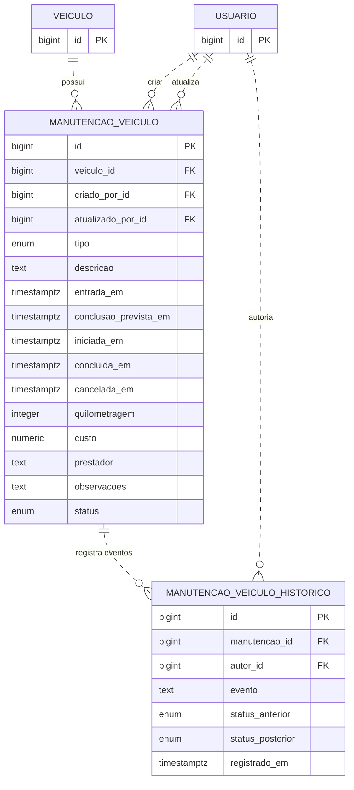

# Sprint 10 — Modelo de manutenção de veículos (SCRUM-230)

## Objetivo, escopo e fontes

DB-S10-02-A especifica o histórico de manutenção por veículo e sua relação com a disponibilidade institucional e SVO. A entrega é documental. A base analisada é `aa1bac3`. **DEFINIÇÃO DO RESPONSÁVEL** identifica regra de negócio fornecida para a tarefa, com homologação institucional formal ainda pendente. **PROPOSTA** identifica uma opção técnica para revisão e **PENDENTE** indica decisão em aberto.

A separação entre histórico próprio e o status manual `veiculo.status = EM_MANUTENCAO`, a preservação das regras existentes e a precedência da especificação e do contrato homologados sobre o protótipo são premissas solicitadas para esta etapa. O responsável pela tarefa forneceu uma referência visual do Lovable. O código `src/routes/manutencoes.tsx` não foi validado porque está indisponível no checkout, inclusive sob `frontend/`. Para implementação, prevalecem o documento e o contrato homologados. A [tela de veículos](../../frontend/src/pages/veiculos/Veiculos.tsx) e sua [apresentação de status](../../frontend/src/pages/veiculos/VehiclePresentation.tsx) são as referências visuais locais. O resumo fornecido pelo responsável para as três imagens do Lovable registra:

- **Card** com placa, vínculo, descrição, tipo, status, entrada, previsão, prestador e custo registrado. Placa e vínculo vêm do veículo.
- **Modal de detalhes** com serviço, tipo, status, entrada, previsão, conclusão, quilometragem, prestador, custo e observações.
- **Modal de edição** com os campos obrigatórios e opcionais da tabela abaixo.

As datas aparecem sem horário visível. A definição técnica local adota dias completos em America/Maceio. A entrada e a previsão são datas civis inclusivas. A janela termina no início do dia civil seguinte à previsão.

Fontes de banco: [schema](./schema.sql), [metadados](./schema-metadata.json), [dicionário](./dicionario.md), [DER](./der.mmd), [migrations](../../backend/src/database/supabase/migrations) e [guia de banco](./README.md). Fontes de comportamento: [veículos](../api/veiculos.md), [agenda](../api/solicitacoes-agenda.md), [OpenAPI](../api/openapi.yaml), [alocação compartilhada](../../backend/src/modules/alocacao/alocacao.repository.ts), [SVO operacional](../../backend/src/modules/svo/svo.operacional.repository.ts) e [execução de viagens](../../backend/src/modules/viagens/viagens.repository.ts).

## Inventário confirmado no checkout

O snapshot versionado contém 17 tabelas e oito enums: `perfil_usuario`, `status_motorista`, `status_ordem_coleta`, `status_solicitacao`, `status_triagem_svo`, `status_veiculo`, `status_viagem` e `tipo_veiculo`. Ainda não há tabela ou enum de manutenção no snapshot nem operação própria no OpenAPI.

- `veiculo.id` e `usuario.id` são PKs BIGINT com sequência. A placa é única. `veiculo.status` aceita NULL, tem default `DISPONIVEL` e admite `DISPONIVEL`, `EM_VIAGEM`, `EM_MANUTENCAO` e `INDISPONIVEL`. `is_svo` e `vinculo` são atributos separados. Hoje, uma edição que muda efetivamente o status para `EM_MANUTENCAO` notifica ADM e GESTOR_FROTA ativos na mesma transação.
- Solicitação institucional, viagem e ordem SVO referenciam veículo. A solicitação tem FK com `ON DELETE SET NULL`; viagem e ordem usam a ação padrão. Há vínculos adicionais em abastecimentos, documentos, anexos e anotações. `viagem.solicitacao_id` é único. Saída e retorno previstos são timestamps sem fuso no legado institucional; o retorno aceita NULL e, quando preenchido, deve ser posterior à saída.
- Há índices parciais de reserva institucional por veículo e motorista com saída e retorno, e índice parcial SVO por veículo e status. O código usa consultas e locks para concorrência entre fluxos.
- A autoria de abastecimento usa `criado_por_id`. O ator da sessão é passado ao serviço de auditoria na mesma transação, como também ocorre em anotações. `log_atividade` tem `usuario_id`, `descricao`, `data_hora`, `tipo_evento` e FK específica de solicitação.
- O snapshot mostra grants amplos de `anon` e `authenticated` e RLS desligada em tabelas legadas de frota e alocação. Anexos, anotações e histórico documental usam revogações explícitas e RLS habilitada. A [documentação de segurança](../seguranca.md) diferencia esses metadados da exposição real da Data API e do papel efetivo do backend.

As 14 migrations versionadas na base analisada são:

| Versão | Evolução |
| --- | --- |
| `20261030000000` | Baseline |
| `20261103000000` | Triagem SVO |
| `20261104000000` | Finalidade da solicitação |
| `20261104000001` | Estado APROVADA |
| `20261104000002` | Retorno previsto |
| `20261104000003` | Vínculo de solicitação no log |
| `20261105000000` | Índices de consultas institucionais |
| `20261109000000` | Comprovante de abastecimento |
| `20261109100000` | Notificações |
| `20261109200000` | Execução de viagem |
| `20261111000000` | Tipo de evento no log |
| `20261112000000` | Documentos e evidências |
| `20261113000000` | Abastecimentos RF40 |
| `20261114000000` | Validação das constraints RF40 |

## Modelo lógico proposto

`public.veiculo` (1) → `public.manutencao_veiculo` (0..N). Cada ocorrência pertence a exatamente um veículo. A proposta usa FKs sem cascata para manter a identificação do veículo e dos autores no histórico. Baixa do veículo, exclusão do usuário e retenção precisam de decisão operacional antes da implementação.

O DER conceitual mostra as chaves e os atributos de negócio da ocorrência. A definição técnica local inclui histórico próprio por ocorrência, com estados e snapshots tipados das datas, autor e instante de registro.



A obrigatoriedade dos campos de negócio e os valores de tipo e status seguem a **definição do responsável**. Nomes físicos, tipos, limites técnicos, defaults e metadados são **propostas**. “Servidor” indica preenchimento interno e “condicional” indica exigência na transição correspondente.

| Campo | Tipo PostgreSQL | Obrigatoriedade | NULL | Default | Limites, FK e justificativa |
| --- | --- | --- | --- | --- | --- |
| `id` | BIGINT | Servidor | Não | Identidade gerada | PK. Representar em JSON como string decimal para preservar precisão |
| `veiculo_id` | BIGINT | Criação | Não | — | FK para `veiculo(id)`. Associa a ocorrência à frota |
| `tipo` | Enum próprio `tipo_manutencao_veiculo` | Criação | Não | — | `PREVENTIVA` ou `CORRETIVA`. Classificação operacional |
| `descricao` | TEXT | Criação | Não | — | 1–2.000 caracteres após aparar bordas, sem texto só em branco. Identifica o serviço |
| `entrada_em` | TIMESTAMPTZ | Criação, inclusive corretiva imediata | Não | — | Data de entrada como meia-noite em America/Maceio. Início inclusivo |
| `conclusao_prevista_em` | TIMESTAMPTZ | Criação, inclusive corretiva imediata | Não | — | Data prevista como meia-noite em America/Maceio. O limite exclusivo é a meia-noite do dia civil seguinte |
| `iniciada_em` | TIMESTAMPTZ | Condicional | Sim | NULL | Obrigatório após início. Registra início efetivo |
| `concluida_em` | TIMESTAMPTZ | Condicional | Sim | NULL | Obrigatório em `CONCLUIDA`. Propor instante igual ou posterior ao início real do ciclo. Preservar conclusões anteriores ao reabrir |
| `cancelada_em` | TIMESTAMPTZ | Condicional | Sim | NULL | Obrigatório em `CANCELADA`. Cancelamento permitido a partir de `AGENDADA` |
| `quilometragem` | INTEGER | Criação | Não | — | Inteira de 0 a 2.147.483.647. Leitura associada à ocorrência, sem atualizar o odômetro global. Momento da coleta a homologar |
| `custo` | NUMERIC | Opcional | Sim | NULL | Campo monetário único, sem precisão ou escala fixa. Valor finito e não negativo |
| `prestador` | TEXT | Opcional | Sim | NULL | 1–255 caracteres após aparar bordas se informado. Identificação textual até homologar cadastro próprio |
| `observacoes` | TEXT | Opcional | Sim | NULL | 1–2.000 caracteres após aparar bordas se informado. Contexto complementar |
| `status` | Enum próprio `status_manutencao_veiculo` | Obrigatório | Não | — | Quatro estados da matriz. Estado consistente com a operação autorizada |
| `criado_por_id` | BIGINT | Servidor | Não | — | FK para `usuario(id)`. Ator autenticado da criação |
| `atualizado_por_id` | BIGINT | Servidor | Não | — | FK para `usuario(id)`. Igual ao autor na criação, atualizado nas mutações |
| `criado_em` | TIMESTAMPTZ | Servidor | Não | `CURRENT_TIMESTAMP` | Instante de registro |
| `atualizado_em` | TIMESTAMPTZ | Servidor | Não | `CURRENT_TIMESTAMP` | Renovado na mesma transação de cada alteração efetiva |

**Custo desconhecido é NULL.** Zero representa custo conhecido igual a zero. Usar `NUMERIC` para custo. A representação como string decimal na API é proposta. Moeda e limites de negócio seguem pendentes.

| Cenário sintético | Valores registrados | Interpretação |
| --- | --- | --- |
| Custo desconhecido após conclusão | `CONCLUIDA`, `custo = NULL` | Custo ainda desconhecido |
| Custo zero confirmado | `CONCLUIDA`, `custo = "0.00"` na representação proposta da API | Custo conhecido igual a zero |
| Agendamento cancelado antes do início | `CANCELADA`, `cancelada_em = 2026-12-09T10:00:00-03:00`, `iniciada_em = NULL`, `concluida_em = NULL`, `custo = NULL` | Preserva a ocorrência, encerra seu bloqueio e mantém o custo desconhecido |

## Estados e casos operacionais

| Origem | Destino | Situação | Condição |
| --- | --- | --- | --- |
| Criação ordinária | AGENDADA | PROPOSTA | Validar dados e disponibilidade |
| AGENDADA | AGENDADA | PROPOSTA | Reagendamento revalida a nova janela e preserva a anterior se houver conflito |
| AGENDADA | EM_ANDAMENTO | DEFINIÇÃO DO RESPONSÁVEL | Registrar início real. Início antecipado permitido mediante validação de disponibilidade |
| AGENDADA | CANCELADA | DEFINIÇÃO DO RESPONSÁVEL | Preservar ocorrência e registrar instante e ator. Motivo não obrigatório |
| EM_ANDAMENTO | CONCLUIDA | DEFINIÇÃO DO RESPONSÁVEL | Registrar término real e encerrar apenas o bloqueio da ocorrência |
| EM_ANDAMENTO | CANCELADA | VEDADA PELO RESPONSÁVEL | Recusar a operação sem alterar a ocorrência |
| Criação corretiva imediata | EM_ANDAMENTO | PERMITIDA PELO RESPONSÁVEL | Entrada e previsão obrigatórias. Criação direta em `EM_ANDAMENTO` é proposta técnica |
| CONCLUIDA | CONCLUIDA | DEFINIÇÃO TÉCNICA LOCAL | Correções de datas operacionais são permitidas com validação, autoria e snapshots anterior e posterior. Demais campos de negócio também são editáveis com validação e auditoria |
| CONCLUIDA | AGENDADA ou EM_ANDAMENTO | DEFINIÇÃO TÉCNICA LOCAL | Revalidar disponibilidade, preservar estados e datas no histórico e limpar a conclusão corrente. Novo início ausente em AGENDADA e obrigatório em EM_ANDAMENTO. Pode receber novas datas planejadas |
| CANCELADA | CANCELADA | EDIÇÃO CONFIRMADA PELO RESPONSÁVEL | Editar campos permitidos sem limpar o instante de cancelamento |
| CANCELADA | AGENDADA ou EM_ANDAMENTO | DEFINIÇÃO TÉCNICA LOCAL | Reativar com concorrência, guarda e preservação estruturada do cancelamento |
| CANCELADA | CONCLUIDA | VEDADA | Não admite conclusão direta |

**Reabertura.** Propor o mesmo lock de veículo usado na alocação, releitura de conflitos e gravação na mesma transação. Se houver conflito, preservar a manutenção concluída, as reservas e as ordens SVO. Registrar evento de reabertura com ID, ator real, instante e referência à conclusão anterior. Preservar cada conclusão em histórico consultável, inclusive após novos ciclos. A tabela própria registra evento, estados anterior e posterior, datas operacionais e planejadas antes e depois, ator e instante. As regras de autorização, concorrência e escrita atômica pertencem ao backend.

O atraso é calculado na leitura, sem coluna própria. A proposta distingue início atrasado em `AGENDADA` e atraso na conclusão em `EM_ANDAMENTO` após o limite da janela de dias completos. Uma manutenção agendada com janela vencida e sem início registrado continua bloqueando o veículo.

`EM_MANUTENCAO` manual continua bloqueando os caminhos que hoje exigem veículo `DISPONIVEL`. A proposta mantém esse sinal operacional independente, sem backfill, sem criar ocorrência ao editar o status e sem trocar automaticamente o veículo para `DISPONIVEL` ao concluir ou cancelar. A SCRUM-233 revalida o status manual e a manutenção registrada no início da viagem. A alteração administrativa de status é independente das reservas existentes, que permanecem registradas.

## Disponibilidade e conflitos

A agenda lista as reservas institucionais `AGENDADA` com interseção. A disponibilidade e as gravações institucionais consideram `AGENDADA`, `PRONTA_PARA_INICIAR` e `EM_ANDAMENTO`. Uma reserva em andamento ou com retorno ausente/inválido bloqueia conservadoramente na verificação atual. Ordens SVO `EM_DESLOCAMENTO` e `EM_TRANSPORTE` bloqueiam o uso institucional sem fim conhecido. Aprovação sem alocação não constitui reserva.

| Situação existente | Nova ação de manutenção | Ação de alocação diante de manutenção |
| --- | --- | --- |
| Reserva institucional com janela válida | Recusar janela sobreposta. Ao iniciar, editar com impacto na janela ou reabrir, reavaliar o bloqueio efetivo e preservar a reserva em conflito | Agendar ou reagendar só em janela livre. Reagendamento exclui apenas sua própria reserva e preserva a anterior se falhar |
| Reserva sem retorno válido ou viagem institucional em execução | Reserva sem retorno válido bloqueia conservadoramente. Viagem ativa sem fim confiável admite manutenção futura agendada. Início efetivo da manutenção durante viagem ativa é recusado | No início de viagem já reservada, verificar manutenção que bloqueie a operação. Na conclusão de viagem em curso, preservar o encerramento operacional |
| Ordem SVO ativa | Preservar coleta ativa. Revalidar a disponibilidade no início, na edição com impacto no bloqueio e na reabertura. Manutenção futura agendada é permitida mesmo sem previsão de término da ordem | Bloquear despacho sobre veículo com manutenção ativa ou janela efetivamente impeditiva. Despacho antes da entrada de manutenção futura é permitido |
| Manutenção com janela vencida sem início ou em andamento | Preservar o bloqueio apesar da previsão de conclusão. Conclusão ou cancelamento válido encerra somente o respectivo bloqueio | Impedir seleção, alocação e despacho enquanto persistir o bloqueio |
| Compartilhamento SVO operacional | Ocupação parcial continua sendo uso ativo para fins de manutenção | O compartilhamento atual admite ordens no mesmo veículo elegível até quatro corpos, com quantidades conhecidas. Preservar a regra de capacidade e demais filtros. Um bloqueio de manutenção impede uso mesmo com vaga restante |

A manutenção `AGENDADA` bloqueia na janela planejada e continua bloqueando se essa janela vencer sem início registrado. `EM_ANDAMENTO` mantém o bloqueio independentemente da previsão de conclusão. O veículo fica indisponível para seleção enquanto houver bloqueio. Conclusão ou cancelamento permitido encerra apenas o bloqueio daquela ocorrência. Preservar outras causas de indisponibilidade, reservas institucionais e ordens SVO existentes. A proposta transacional rejeita novas operações conflitantes sem deslocar vínculos existentes. O início efetivo de manutenção é revalidado mesmo se uma operação em curso ultrapassar a data planejada.

Exemplos sintéticos em `America/Maceio` (`-03:00` nestas datas). Calcular o fim exclusivo somando um dia à **data civil** da previsão e convertendo a nova meia-noite em instante.

| Manutenção | Reserva ou ação | Resultado |
| --- | --- | --- |
| Entrada e previsão em 10/12/2026 | Reserva termina em 10/12 às 00:00 | Adjacente ao início |
| Entrada e previsão em 10/12/2026 | Reserva começa em 11/12 às 00:00 | Adjacente ao fim planejado. Revalidar bloqueio efetivo na execução |
| Entrada e previsão em 10/12/2026 | Reserva em 10/12 das 10:30 às 11:30 | Sobreposição |
| Agendada até 10/12/2026, sem início em 11/12 às 11:30 | Nova seleção | Permanece bloqueada |
| Iniciada em 10/12/2026 às 09:00, em andamento em 11/12 às 11:30 | Nova seleção | Permanece bloqueada |
| Concluída às 10:00, corrigida para 11:00 e reaberta para AGENDADA | Consulta do histórico | Correção registra 10:00 e 11:00. Reabertura preserva 11:00 no snapshot anterior e mantém a conclusão corrente vazia |


## Concorrência, integridade e acesso

- Em transação READ COMMITTED, usar a linha do veículo como ponto comum de serialização. Quando o fluxo também bloqueia motoristas, manter motorista antes de veículo e ordenar IDs de cada conjunto. Preservar a ordem existente de solicitação ou ordem antes dos recursos. O fluxo de manutenção adquire o veículo antes de bloquear sua ocorrência e consulta conflitos sem bloquear outras solicitações ou ordens. Revalidar depois dos locks e concluir a gravação e a auditoria juntas.
- Aplicar o protocolo em criação, alteração com impacto na disponibilidade, início e reabertura de manutenção, agendamento/reagendamento, início de viagem e nos dois caminhos de despacho SVO. Listas de disponibilidade, recursos e ocupação SVO devem refletir o bloqueio. O bloqueio manual é revalidado no início de viagem sem cancelar a reserva. A corrida entre manutenção e alocação deve resultar em uma única gravação quando incompatíveis.
- Propor CHECKs de ordem dos instantes, coerência entre status e timestamps, limites de texto, quilometragem e valores não negativos e finitos. FK e PK protegem identidade. Transições e conflitos entre tabelas dependem de validação transacional. Índices candidatos: histórico por veículo, entrada e ID. Para disponibilidade, avaliar índice parcial por veículo, status e entrada que também cubra agendamentos vencidos. Unicidade e exclusão de intervalos entre ocorrências seriam incompatíveis com a permissão de múltiplas manutenções simultâneas.
- Atribuir autoria pela sessão ativa. Registrar eventos de criação, reagendamento, edição após conclusão, reabertura e demais transições no serviço de auditoria existente, com ID da ocorrência e ator, na mesma transação. Pendente homologar motivos, correções e a necessidade de vínculo estruturado no log. Evitar copiar observações e custos para logs de infraestrutura.
- Acesso por API com autorização por ação. Pela definição do responsável, ADM e GESTOR_FROTA podem consultar, cadastrar, editar, iniciar, concluir, cancelar quando permitido e reabrir. O backend verifica o perfil efetivo e registra o ator da sessão. Propor RLS habilitada e revogar grants diretos de `PUBLIC`, `anon` e `authenticated` para tabela e, quando aplicável, sequência. Confirmar papel efetivo do runtime, propriedade, privilégios herdados, defaults, BYPASSRLS, políticas necessárias e exposição pela Data API antes do rollout. Validar privilégios mínimos em ambiente isolado na tarefa de implementação.

## Evolução futura — anexos opcionais

Avaliar o reaproveitamento do [módulo compartilhado de anexos](../api/anexos.md) para evidências opcionais de uma ocorrência. A estrutura atual aceita anexos de veículo, entre outros recursos, e exige exatamente um vínculo de recurso por anexo. Um anexo de veículo pertence ao cadastro da frota e, por si só, não identifica a ocorrência de manutenção.

O reaproveitamento pode preservar a validação de tipo e tamanho, o registro de autoria e a autorização de upload e download. Antes de definir a solução, homologar quais evidências serão aceitas, quem poderá consultá-las e como tratar retenção e exclusão. O vínculo com a ocorrência fica para uma evolução própria, sem tabela, campo ou relacionamento físico novo nesta etapa.

## Homologação, riscos e critérios de aceite

**Pendências FSPH.** Registrar a homologação institucional formal das definições do responsável. Detalhar moeda e limites de negócio, momento da leitura de odômetro, operação técnica da corretiva imediata, tratamento da edição que reduza sem eliminar conflito legado conhecido, retenção, exclusões, ACL e papel de runtime.

**Riscos.** Fuso implícito pode deslocar janelas. Caminhos de escrita sem lock comum podem confirmar duas operações incompatíveis. Sobrescrever status do veículo na conclusão pode liberá-lo indevidamente. FK restritiva pode afetar exclusões existentes. Índices ou grants herdados podem divergir do esperado no rollout. Expor custo e observações em consultas de disponibilidade amplia o acesso a dados operacionais.

**Aceite documental da SCRUM-230.** A especificação referencia a base e distingue inventário confirmado, propostas e pendências. O modelo explicita cardinalidade, requisitos e defaults. Os cenários incluem adjacência, sobreposição, janela vencida que mantém bloqueio, custos NULL e zero, manutenção manual, conflitos nos dois sentidos e capacidade SVO. O documento registra campos obrigatórios, permissões, edição e reabertura após conclusão e preservação do histórico e das alocações. O diff contém somente documentação da proposta.

**Cenários para aceite futuro.** Cobrir IDs BIGINT, decimal sem perda, NULL versus zero, autoria e rollback da auditoria, concorrência, intervalos adjacentes, reservas sem retorno, viagem em curso, SVO com ocupação parcial e capacidade esgotada, status manual persistente, corretiva imediata com datas obrigatórias, recusa de cancelamento em andamento, bloqueio de seleção após vencer a janela agendada, encerramento sem liberação de outros bloqueios, edição após conclusão, reabertura com e sem conflito, preservação das conclusões anteriores e permissões positivas e negativas. Guardar evidência isolada na tarefa de implementação correspondente.

### Testes obrigatórios previstos no Jira

A descrição oficial da SCRUM-230 no Jira exige a execução, na ordem abaixo, dos seguintes comandos:

```text
npm run db:test:start
npm run db:test:prepare
npm run db:docs:generate
npm run db:docs:check
npm run test:db
```

O Jira também exige SQL com fixtures sintéticas, comparação de integridade, verificação de ACL e logs de rollback como evidência.

**Ainda não executados nesta etapa documental.** Os comandos e as verificações de banco devem ser realizados exclusivamente em ambiente isolado cuja origem seja comprovada pelo harness. Se o Docker estiver indisponível, registrar o bloqueio. O Supabase compartilhado fica excluído como alternativa.

## Consolidação do contrato — SCRUM-232

### Definições locais confirmadas e referência visual

O responsável confirmou a edição de ocorrências canceladas, inclusive mudança de status mediante transição validada, a imutabilidade do veículo após o cadastro, o cancelamento sem motivo obrigatório, o início antecipado condicionado à disponibilidade e a possibilidade de informar novas datas planejadas ao reabrir uma concluída. O filtro de período usa a **data civil de entrada**, com limites inclusivos em `America/Maceio`. A homologação institucional formal permanece pendente.

Nas imagens do Lovable fornecidas pelo responsável, a listagem apresenta filtro de veículo, dois seletores aparentemente de tipo e status (opções não visíveis), entrada a partir de, entrada até e quantidade de registros. Os cards exibem placa, vínculo, descrição, tipo, status, atraso derivado, entrada, previsão, prestador e custo. O detalhe acrescenta conclusão efetiva, quilometragem e observações. A busca textual e a autoria não aparecem nessas telas. A busca foi solicitada para a API.

O formulário de edição mostra veículo, tipo, descrição, entrada, previsão, quilometragem, prestador, custo, status e observações. O veículo fica fixo após o cadastro, mesmo com seletor no protótipo. O status escolhido deve ser convertido em ação validada pelo backend. O botão “Cancelar” pode apenas fechar o formulário. “Observações e comentários” pode ser somente o campo de observações. O custo desconhecido permanece `NULL` mesmo quando o protótipo exibe R$ 0,00. O código Lovable segue indisponível no checkout.

### Matriz de edição por estado

A matriz registra as definições técnicas locais. Campos de negócio são editáveis nos quatro estados. Veículo, IDs, autoria e metadados internos ficam protegidos. Toda mudança de status exige transição explícita e validada. A exclusão física fica fora do contrato.

| Campo ou grupo | AGENDADA | EM_ANDAMENTO | CONCLUIDA | CANCELADA |
| --- | --- | --- | --- | --- |
| Veículo | Fixo | Fixo | Fixo | Fixo |
| Descrição, prestador, custo e observações | Editáveis | Editáveis | Editáveis | Editáveis |
| Quilometragem | Editável | Editável, com validação | Editável | Editável |
| Tipo preventiva/corretiva | Editável com auditoria | Editável com auditoria | Editável com auditoria | Editável com auditoria |
| Entrada e previsão | Editáveis com guarda | Editáveis com validação, disponibilidade e auditoria | Correção auditada. Na reabertura, aceitar novas datas planejadas com guarda | Editáveis enquanto cancelada. Se combinadas com reativação, validar a janela resultante |
| Início, conclusão e cancelamento efetivos | Servidor nas transições | Servidor nas transições | Correção explícita e auditada de datas operacionais aplicáveis | Preservar o instante de cancelamento enquanto cancelada |
| Status | Por ação | Por ação | Por reabertura | Por reativação, com destinos confirmados na matriz de estados |

A mudança de tipo pode alterar elegibilidade da corretiva imediata, classificação histórica e indicadores de preventivas. Registrar tipo anterior e posterior na auditoria transacional, com ID, autor e instante. A trilha de manutenção estruturada guarda estados e datas. Uma consulta estruturada do tipo por ciclo exige desenho adicional aprovado, sem inferência sobre eventos anteriores.

### Contrato de API proposto

| Endpoint | Entrada | Resposta |
| --- | --- | --- |
| `GET /api/manutencoes` | `page`, `limit`, `veiculoId`, `tipo`, `status`, `inicio`, `fim`, `q` | `200 {data: Resumo[], meta: {page, limit, total}}` |
| `POST /api/manutencoes` | Cadastro estrito | `201 {data: Detalhe}` após commit |
| `GET /api/manutencoes/{id}` | ID BIGINT como string | `200 {data: Detalhe}`, com token de versão |
| `PATCH /api/manutencoes/{id}` | Campos editáveis pela matriz e `If-Match` | `200 {data: Detalhe}`, com nova versão se houver alteração |
| `PATCH /api/manutencoes/{id}/status` | Ação estrita e `If-Match`, com edições compatíveis opcionais no mesmo comando | `200 {data: Detalhe}`, após commit |
| `GET /api/veiculos/{id}/manutencoes` | ID do veículo e filtros da lista, sem `veiculoId` | `200 {data: Resumo[], meta}` |
| `GET /api/manutencoes/{id}/historico` | ID da ocorrência, `page`, `limit` | `200 {data: Evento[], meta}` |

O cadastro recebe `veiculoId`, `tipo`, `descricao`, `entrada`, `conclusaoPrevista` e `quilometragem`. `prestador`, `custo`, `observacoes` e `iniciarImediatamente` são opcionais. A intenção imediata só se aplica à corretiva e exige guarda. O status de criação é derivado pelo servidor. Rejeitar campos extras, troca de veículo e autoria injetada. IDs continuam strings BIGINT, inclusive os negativos das fixtures. Custo usa string decimal ou `null`. No PATCH, omissão preserva o valor e `null` limpa somente campo nullable.

O resumo projeta ID, veículo com placa e vínculo, descrição, tipo, status, entrada, previsão, prestador, custo e atraso derivado. O detalhe acrescenta quilometragem, observações, instantes operacionais, metadados de criação e atualização e versão, com autoria reservada ao histórico e à auditoria. O evento inclui ID, ação, estados anterior e posterior, snapshots, autor e instante. Os eventos estruturados atuais são `CONCLUSAO`, `CORRECAO_DATAS` e `REABERTURA`. Cancelamento e reativação entram no DTO após validação da evolução incremental e implementação do contrato.

A busca da API é proposta por placa, descrição e prestador, com parâmetro SQL, comparação sem distinção de caixa e caracteres como `%` e `_` tratados literalmente. Proposta inicial de até 255 caracteres após trim, coerente com o limite de prestador e sujeita à revisão do contrato. Página padrão 1, limite padrão 20 e máximo 100. Ordem estável por entrada e ID decrescentes. Página e total usam o mesmo predicado e snapshot. O histórico por evento ordena por instante e ID decrescentes. Aplicar sessão e RBAC de ADM e GESTOR_FROTA em todas as rotas, com envelopes vigentes de 400, 401, 403, 404, 409 e 500.

### Reativação e edição atômica

A proposta de comando é `{acao: "REATIVAR", destino: "AGENDADA" | "EM_ANDAMENTO", alteracoes?: {...}}`. `REABRIR` continua reservado a concluídas e pode incluir novas datas. As ações `INICIAR`, `CONCLUIR` e `CANCELAR` aceitam apenas as alterações compatíveis com o respectivo comando. Não aceitar um campo genérico `status` em nenhum PATCH. `CANCELADA → CONCLUIDA` diretamente fica fora do fluxo autorizado.

Quando a tela editar campos e status juntos, enviar um único comando ao endpoint de status. Validar a revisão e montar a situação resultante, incluindo as datas novas, em uma transação. Bloquear veículo e depois ocorrência, validar a guarda da SCRUM-233 sobre a situação resultante, persistir edição e transição, escrever histórico e auditoria e responder depois do commit. Qualquer falha reverte o conjunto. O PATCH de campos é suficiente quando não há transição.

O token de versão proposto deriva de `atualizado_em` com microssegundos, sem conversão pelo `Date` do JavaScript. Os PATCHes exigem `If-Match`. Comparar a versão após os locks, avançá-la estritamente a cada mutação efetiva e retornar 409 para revisão obsoleta ou 400 para precondição ausente ou inválida. A reativação depende das guardas da SCRUM-233 para disponibilidade, reservas institucionais e ordens SVO. A escrita foi ativada localmente com a integração, inclusive para início antecipado e edição de janela.

### Impacto no histórico da SCRUM-231

A tabela corrente aceita os dois destinos confirmados após reativação, com `cancelada_em = NULL`. Em `AGENDADA`, o início fica vazio. Em `EM_ANDAMENTO`, deve existir início efetivo. O CHECK atual exige o timestamp de cancelamento somente enquanto `CANCELADA`.

A estrutura histórica atual não aceita `CANCELAMENTO` ou `REATIVACAO`, exige início anterior e não armazena `cancelada_em` nos snapshots. Limpar o campo na ocorrência corrente perde o instante estruturado se ele não for preservado em outro lugar. A auditoria geral pode registrar ação, ator, ID na descrição e hora do log, mas não tem vínculo estruturado com manutenção nem snapshot do instante anterior. Ela atende ao registro geral da ação, sem substituir o histórico por ocorrência em ciclos repetidos.

A evolução incremental foi autorizada para preparação. Ela acrescenta os eventos e snapshots de cancelamento e preserva os históricos anteriores. A mudança corrente e o histórico deverão confirmar na mesma transação. A migration original conserva conteúdo e checksum. A aplicação local da versão nova aguarda autorização. [Detalhes do incremento e rollback](./sprint10-manutencao-cancelamento-reativacao.md).

Cadastro, edição comum e início usam auditoria geral conforme a rastreabilidade exigida. Mudanças de tipo e de datas em andamento devem preservar os valores relevantes de antes e depois. Cancelamento e reativação também usam a trilha incremental. Conclusão, correção de datas e reabertura de concluída mantêm o histórico próprio. As operações exigem autoria da sessão e rollback integral se falhar uma gravação obrigatória.

### Pendências e insumos para a SCRUM-234

A documentação da SCRUM-232 detalha auditoria, busca e token. As guardas locais da SCRUM-233 estão descritas na seção de integração. Runtime compartilhado e homologação institucional formal seguem pendentes.

Registrar para a SCRUM-234: veículos em manutenção, agendadas, concluídas, atrasadas, custo no período e alerta de preventivas nos próximos sete dias. As definições de contagem, período e reativações para indicadores ficam para essa tarefa.

## Rastreabilidade e próximos artefatos

| Item | Vínculo confirmado pelo enunciado do Jira | Detalhes a confirmar |
| --- | --- | --- |
| SCRUM-231 | Dependência | Consumir a especificação homologada como pré-requisito para quem materializar o esquema. Confirmar atribuição |
| SCRUM-232 | Dependência | Disponibilizar matriz de transições, autoria e requisitos de segurança. Confirmar atribuição |
| SCRUM-233 | Dependência | Disponibilizar matriz de conflitos, integração bilateral e protocolo de locks. Confirmar atribuição |
| SCRUM-235 | Dependência | Disponibilizar cenários de aceite e evidências de compatibilidade. Confirmar atribuição |
| SCRUM-219 | Relação com a SCRUM-230 | Validar a relação com o fluxo de disponibilidade da Sprint 10, em especial critérios de elegibilidade e conflitos. Escopo, vínculo formal e direção da dependência pendentes de confirmação |

O enunciado do Jira, conforme informado nesta revisão, confirma as quatro dependências e a relação com SCRUM-219. Ficam pendentes os detalhes de escopo, atribuição e, quando aplicável, direção do vínculo. A subtask indica **Pai SCRUM-216**, enquanto a tarefa principal aparece como **DB-S10-02**. A primeira é uma chave de item e a segunda um identificador de entrega. Confirmar no backlog se apontam para a mesma entrega e registrar a referência validada na homologação.

O [dicionário](./dicionario.md) e o [DER](./der.mmd) descrevem o banco vigente. A [API de veículos](../api/veiculos.md) e a [API de agenda](../api/solicitacoes-agenda.md) descrevem os contratos atuais. Na etapa de banco autorizada, atualizar o dicionário e regenerar schema, metadados e DER a partir do alvo isolado. Na etapa de API, atualizar a fonte dos contratos e os documentos dos módulos afetados, incluindo veículos e agenda se seu comportamento mudar, e regenerar OpenAPI e consumidor pelo fluxo oficial. A implementação deve começar após a homologação das regras aplicáveis e a confirmação dos vínculos no backlog.

## Integração local da guarda de alocação

A SCRUM-233 aplica as definições locais registradas em [decisões](../decisions.md).
Uma ou mais manutenções agendadas podem se sobrepor, e mais de uma manutenção
pode ficar em andamento para o mesmo veículo. Cada ocorrência mantém seu
próprio bloqueio e histórico. Conclusão ou cancelamento válidos não removem
bloqueios de outras ocorrências nem alteram o status manual.

Manutenção futura agendada pode ser criada enquanto um atendimento SVO ou
uma viagem sem término confiável estiver em execução. Conflitos conhecidos
com reservas institucionais são recusados. O SVO pode despachar antes da
entrada planejada e preservar o atendimento em curso. O início efetivo de
manutenção espera o encerramento das operações ativas. O início de viagem
considera o novo instante, o retorno previsto e o status manual do veículo.
O término exclusivo é a meia-noite local após a previsão. A janela
agendada vencida ou a manutenção em andamento impede novas alocações.

A homologação institucional formal permanece pendente. A referência à
SCRUM-240 no enunciado da SCRUM-233 foi confirmada como inconsistente pelo
responsável e não constitui dependência.


## Revisões dos alertas persistentes — SCRUM-234

A revisão tem relação 1:N com a ocorrência e dois tipos possíveis de
alerta por chave composta. Ela é limitada ao estado de emissão e
não altera o histórico nem o status manual. Consulte a estrutura,
a ordem de locks e a ativação em [notificações](../api/notificacoes.md).
